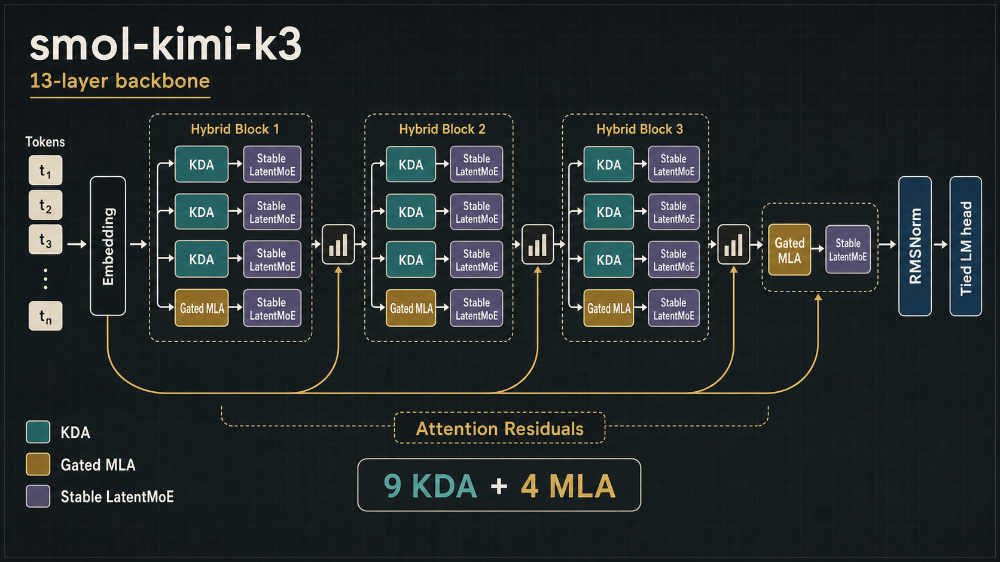
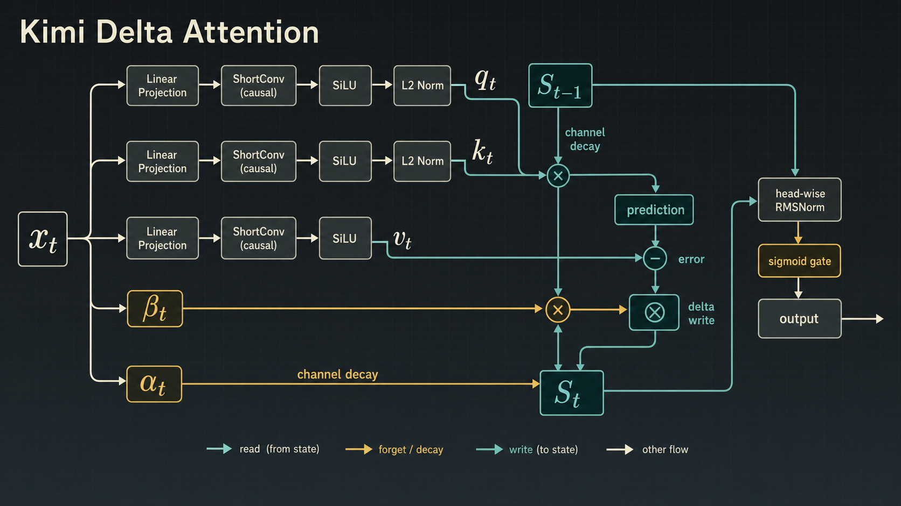
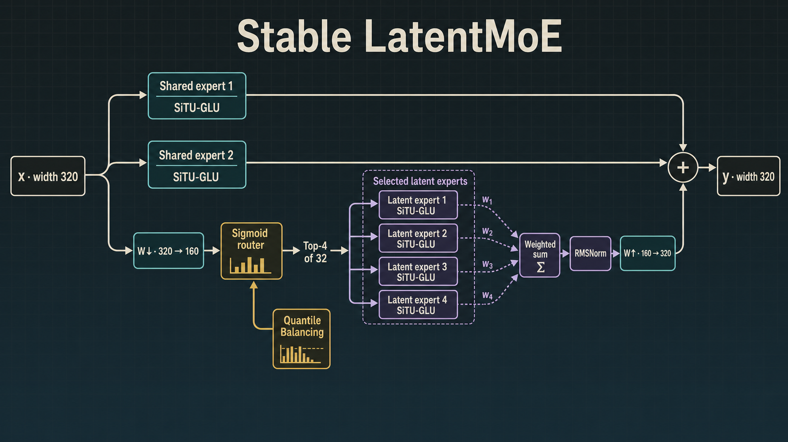
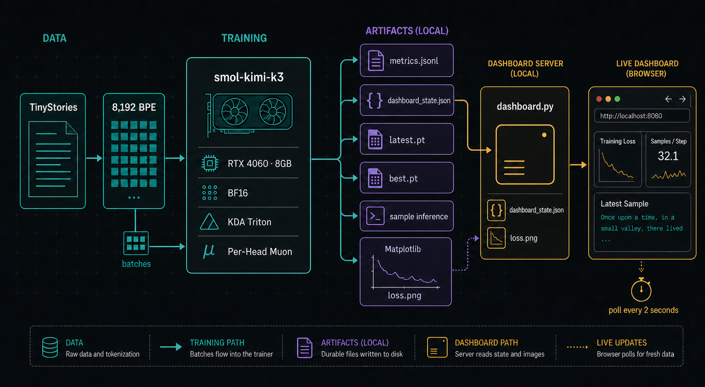

<div align="center">

# smol-kimi-k3

### A 49M-parameter, Kimi K3-inspired language model you can train on one 8GB GPU

[](#model-card)
[](#measured-on-an-rtx-4060-laptop-gpu)
[](https://pytorch.org/)
[](https://huggingface.co/datasets/roneneldan/TinyStories)
[](#verification)

**KDA · Gated MLA · Attention Residuals · Stable LatentMoE · SiTU-GLU · Per-Head Muon**

[Quick start](#quick-start) · [Architecture](#architecture) · [Dashboard](#live-training-dashboard) · [Benchmarks](#measured-on-an-rtx-4060-laptop-gpu)

</div>

---

`smol-kimi-k3` is a training-oriented, text-only miniature of the language
backbone described in Moonshot AI's
[Kimi K3 technical report](https://github.com/MoonshotAI/Kimi-K3/blob/main/k3_tech_report.pdf).
It compresses the defining ideas of a 2.8-trillion-parameter frontier model
into **49,019,770 trainable parameters**, then trains that model from scratch
on TinyStories using a single RTX 4060 Laptop GPU.

This is an architecture study, not a claim that 49M parameters reproduce the
capabilities of Kimi K3. The point is to make the interesting machinery small
enough to read, run, modify, and train at home.

> [!NOTE]
> The first CUDA call builds the KDA Triton kernels and can take roughly
> 75 seconds. Later runs reuse the cache and start normally.

## Why this exists

Most "tiny reproductions" replace the unusual parts of a frontier model with a
standard Transformer. This project keeps the unusual parts:

- a `3 KDA : 1 Gated MLA` hybrid attention rhythm, followed by a final MLA layer;
- channel-wise, lower-bounded Kimi Delta Attention with ShortConv;
- data-dependent Attention Residuals across network depth;
- sparse Stable LatentMoE channel mixing;
- bounded SiTU-GLU experts and exact small-batch Quantile Balancing;
- NoPE global attention;
- Muon for matrices and Per-Head Muon for attention projections;
- cached KDA/MLA autoregressive decoding;
- a tiny live dashboard backed by Matplotlib artifacts.

## Architecture

### 1. The 13-layer backbone

Kimi K3 repeats three KDA layers followed by one global MLA layer, then ends
with an additional global layer. `smol-kimi-k3` preserves that composition:
**9 KDA layers + 4 Gated MLA layers**.

<p align="center">
  
</p>

Every attention and MoE sublayer receives a learned, data-dependent mixture of
the embedding, completed block summaries, and the current partial block. That
is the miniature implementation of **Block Attention Residuals**: information
can be selected from earlier depths instead of being forced through one
uniform residual stream.

### 2. Kimi Delta Attention

KDA is a finite-state, linear-attention recurrence. Queries and keys pass
through ShortConv, SiLU, and L2 normalization. A learned channel-wise decay
forgets stale state, while the delta rule writes only the error between the
current value and the state's prediction.

<p align="center">
  
</p>

On CUDA, the same recurrence is evaluated with the report-linked
[`fla-core`](https://github.com/fla-org/flash-linear-attention) chunkwise
Triton kernel. A readable FP32 recurrent implementation remains available as
the CPU fallback. Their measured mean absolute output difference is `0.00152`
at BF16, against a mean reference magnitude of `0.22465`.

### 3. Stable LatentMoE

Each layer has two always-on shared experts and 32 compact routed experts. Only
the top four routed experts run for each token.

<p align="center">
  
</p>

SiTU-GLU smoothly caps both multiplicative branches:

```text
gate = 4  · tanh(Wg x / 4)  · sigmoid(Wg x)
up   = 25 · tanh(Wu x / 25)
out  = Wdown(gate ⊙ up)
```

The routed aggregate is normalized before projection back to model width. At
this local scale, Quantile Balancing uses the exact batch quantile instead of
the distributed histogram approximation required by the 2.8T model.

## What was scaled—and what was not

| Component | Kimi K3 report | smol-kimi-k3 |
|---|---:|---:|
| Total parameters | 2.8T | **49.02M** |
| Layers | 93 | **13** |
| Attention composition | 69 KDA + 24 MLA | **9 KDA + 4 MLA** |
| Hidden size | 7,168 | **320** |
| Attention heads | 96 | **5** |
| Routed experts | 896, Top-16 | **32, Top-4** |
| Shared experts | 2 | **2** |
| Latent MoE width | 3,584 | **160** |
| Vocabulary | 160K | **8,192 BPE** |
| Position encoding | NoPE | **NoPE** |
| Vision tower | MoonViT-V2, 401M | **omitted** |
| Training data | multimodal frontier corpus | **TinyStories text** |

The vision encoder is intentionally omitted: at 401M parameters, the upstream
tower alone is eight times larger than this entire model, and TinyStories
contains no visual inputs. Gated MLA preserves low-rank KV compression and
NoPE global attention, but does not attempt to reproduce Moonshot's production
inference kernels.

## Model card

The checked-in configuration lives in
[`configs/k3_50m.json`](configs/k3_50m.json).

| Field | Value |
|---|---:|
| Trainable parameters | **49,019,770** |
| Layers | 13 |
| Hidden size | 320 |
| Heads / head size | 5 / 64 |
| Vocabulary | 8,192 |
| MLA latent size | 128 |
| Latent MoE width | 160 |
| Routed expert hidden size | 168 |
| Routed experts | 32, Top-4 |
| Shared expert hidden size | 192 |
| Shared experts | 2 |
| AttnRes block size | 4 layers |
| Default sequence length | 256 |
| Optimizer | Per-Head Muon + AdamW |
| Precision | BF16 autocast |

## Quick start

### 1. Install

```bash
git clone <your-repository-url> smol-kimi-k3
cd smol-kimi-k3
python3 -m pip install -r requirements.txt
```

### 2. Prepare TinyStories

Full training split plus 10,000 validation stories:

```bash
python3 scripts/prepare_tinystories.py \
  --output-dir data/tinystories
```

Small pipeline check:

```bash
python3 scripts/prepare_tinystories.py \
  --output-dir data/tinystories-smoke \
  --tokenizer-stories 10000 \
  --train-stories 10000 \
  --validation-stories 1000
```

### 3. Start the dashboard

In terminal A:

```bash
python3 dashboard.py \
  --run-dir checkpoints/k3-50m \
  --port 8080
```

Open **[http://127.0.0.1:8080](http://127.0.0.1:8080)**.

### 4. Train

In terminal B:

```bash
python3 train.py \
  --data-dir data/tinystories \
  --output-dir checkpoints/k3-50m \
  --steps 10000
```

The safe defaults are:

```text
micro-batch             16
sequence length         256
gradient accumulation   2
effective token batch   8,192
warmup                  1%
schedule                cosine
weight decay            0.1
sample interval         250 steps
```

Resume from the most recent atomic checkpoint:

```bash
python3 train.py \
  --data-dir data/tinystories \
  --output-dir checkpoints/k3-50m \
  --steps 10000 \
  --resume checkpoints/k3-50m/latest.pt
```

Generate a story:

```bash
python3 generate.py checkpoints/k3-50m/best.pt \
  --prompt "Once upon a time, a little fox"
```

## Live training dashboard

The monitor deliberately stays simple: the trainer writes durable files, and
the local web page polls them every two seconds.

<p align="center">
  
</p>

The page shows:

- current step and run status;
- train and validation cross-entropy;
- measured tokens per second;
- peak allocated VRAM;
- the Matplotlib loss curve;
- the latest cached autoregressive sample.

Change sample cadence with `--sample-interval`, change its length with
`--sample-tokens`, or use `--skip-samples` for pure throughput benchmarking.

## Measured on an RTX 4060 Laptop GPU

Synthetic full optimizer steps at BF16, sequence length 256:

| Micro-batch | Throughput | Peak allocated | Peak reserved |
|---:|---:|---:|---:|
| 8 | 424 tok/s | 2.12 GiB | — |
| **16** | **901 tok/s** | **4.01 GiB** | — |
| 24 | 1,318 tok/s | 5.84 GiB | 6.35 GiB |

Batch 16 is the default because it leaves room for the display driver,
evaluation, other desktop applications, and dashboard sample generation. If
other applications consume substantial VRAM, use:

```bash
python3 train.py \
  --batch-size 8 \
  --gradient-accumulation 4
```

An end-to-end TinyStories verification step measured:

| Check | Result |
|---|---:|
| Parameters | 49,019,770 |
| Train loss after step 0 | 9.0381 |
| Validation loss | 8.9360 |
| Throughput | 1,268 tok/s |
| Peak allocated VRAM | 4.01 GiB |
| Dashboard artifacts | JSONL + state + PNG + sample |

These values verify the pipeline; they are not final model-quality results.

## Repository map

```text
smol-kimi-k3/
├── configs/
│   └── k3_50m.json              # authoritative model shape
├── dashboard/
│   ├── index.html               # barebones live UI
│   ├── styles.css
│   └── app.js
├── k3/
│   ├── config.py
│   ├── model.py                 # KDA, MLA, AttnRes, LatentMoE, decoding
│   ├── monitoring.py            # JSONL state + Matplotlib rendering
│   └── optim.py                 # Muon, Per-Head Muon, AdamW split
├── scripts/
│   └── prepare_tinystories.py
├── tests/
│   └── test_model.py
├── dashboard.py                 # local HTTP server
├── generate.py
└── train.py
```

## Verification

```bash
python3 -m pytest -q
```

The test suite checks:

1. the report's `3 KDA + 1 MLA` layer composition;
2. forward, loss, backward, and router-bias behavior;
3. causal invariance;
4. cached token-by-token decoding against full-sequence logits;
5. the 48–52M parameter budget;
6. dashboard state, metric, sample, and Matplotlib artifacts.

Expected result:

```text
6 passed
```

## Design notes

- **KDA training:** official FLA chunkwise Triton kernel on CUDA; readable
  recurrent FP32 fallback on CPU.
- **KDA decoding:** recurrent state and ShortConv caches are carried one token
  at a time.
- **MLA decoding:** global key/value caches are retained per layer.
- **Routing:** biases select experts, but do not alter normalized mixture
  weights, matching the auxiliary-loss-free design.
- **Balancing:** exact quantiles replace distributed histograms because a
  single-device batch is small.
- **Optimizer split:** matrix parameters use Muon; Q/K/V matrices are
  orthogonalized per head; embeddings, norms, biases, and scalars use AdamW.
- **Checkpointing:** `latest.pt` and `best.pt` are written through a temporary
  file and atomically renamed.

## Acknowledgements

This project is derived from ideas presented by the
[Kimi Team](https://github.com/MoonshotAI/Kimi-K3) and uses the
[Flash Linear Attention](https://github.com/fla-org/flash-linear-attention)
KDA implementation. TinyStories was introduced by Eldan and Li and is consumed
through the [Hugging Face dataset](https://huggingface.co/datasets/roneneldan/TinyStories).

Please consult the upstream repositories and technical report for their
respective licenses, citations, and authoritative architectural details.

---

<div align="center">

**Big architecture, small GPU.**

</div>
